# 实践项目2：个人实验报告

## 1. 基本信息
- GitHub 账号：PL666pl
- 仓库地址：https://github.com/PL666pl/my-docs
- 在线网站地址：https://pl666pl.github.io/my-docs/

## 2. 实践过程与截图记录
### 2.1 仓库创建
操作：在 GitHub 平台新建公开仓库 `my-docs`，作为项目代码远程仓库，用于存放文档源码、配置文件与本次实验报告。
目的：搭建代码托管环境，实现版本管理，为后续自动部署提供基础。
结果：仓库创建成功，可正常提交文件。
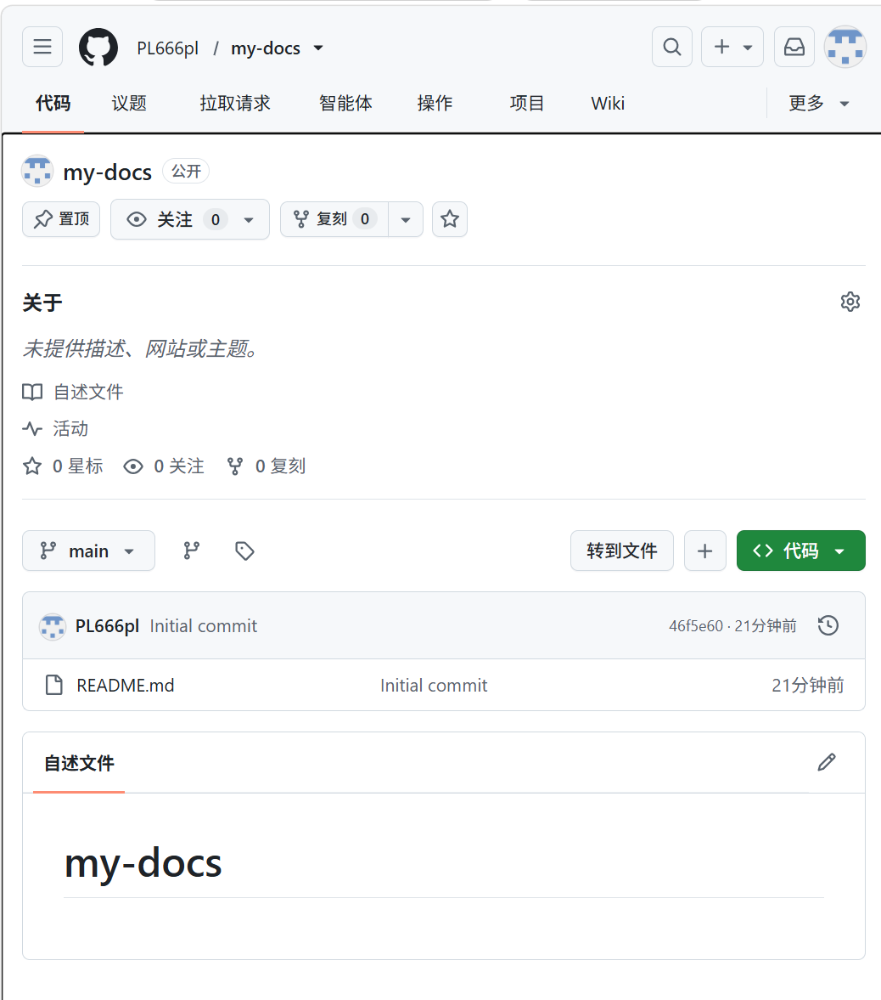

### 2.2 项目结构与 MkDocs 配置
操作：编写 `mkdocs.yml` 配置文件，设置网站名称、访问地址、主题与语言，通过 `nav` 配置导航菜单，关联 docs 目录下四份 Markdown 文档。
- `docs/`：存放 index.md、about.md、guide.md、api.md 等 Markdown 源码文档，是我们编辑维护的原始内容；
- `nav`：导航配置项，定义网站导航文字，绑定对应的文档文件，控制页面跳转；
- `site/`：执行 `mkdocs build` 后自动生成的静态网页文件夹，包含 HTML、CSS、JS，属于编译产物，每次构建都会覆盖，**不能手动修改**。
结果：一共配置4个页面，导航配置生效，MkDocs 可以正常构建网站。
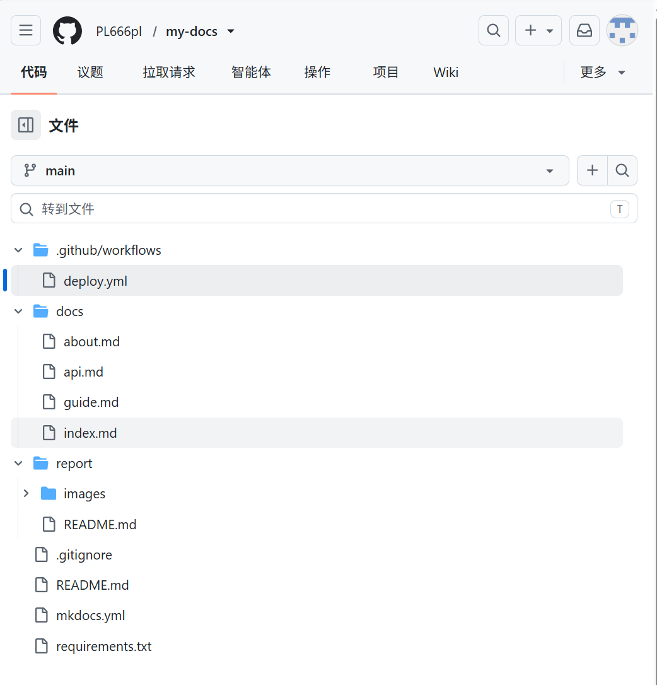
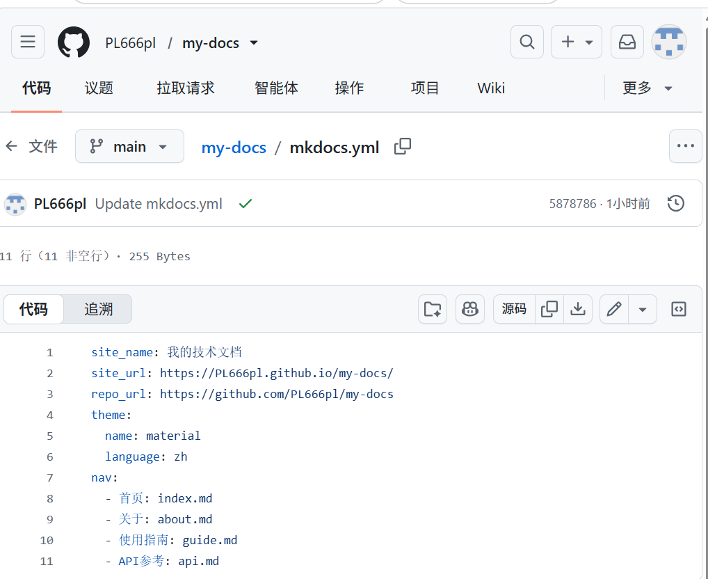

### 2.3 本地构建或预览
操作：本地终端执行 `mkdocs serve` 启动预览服务，依次打开四个页面进行检查。
检查内容：
1. 网站标题、Material主题、中文展示效果和 `mkdocs.yml` 配置保持一致；
2. 首页、关于、使用指南、API参考四个导航页面均可正常切换；
3. Markdown 内容渲染正常，无乱码、排版错乱；
4. 本地验证无误后再推送代码，避免线上部署出错。
结果：本地预览成功，4个页面全部加载正常，导航跳转流畅。
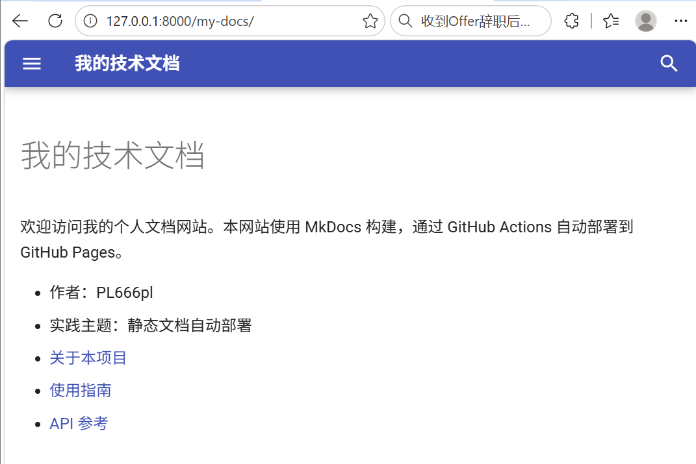
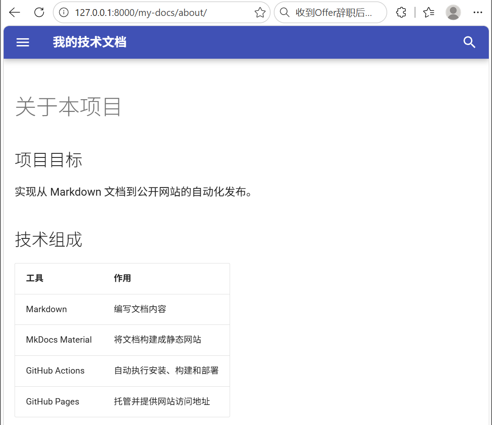
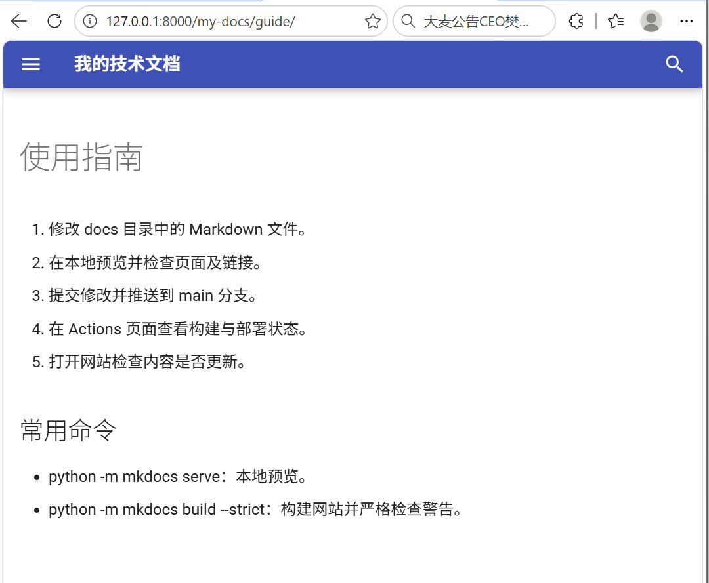
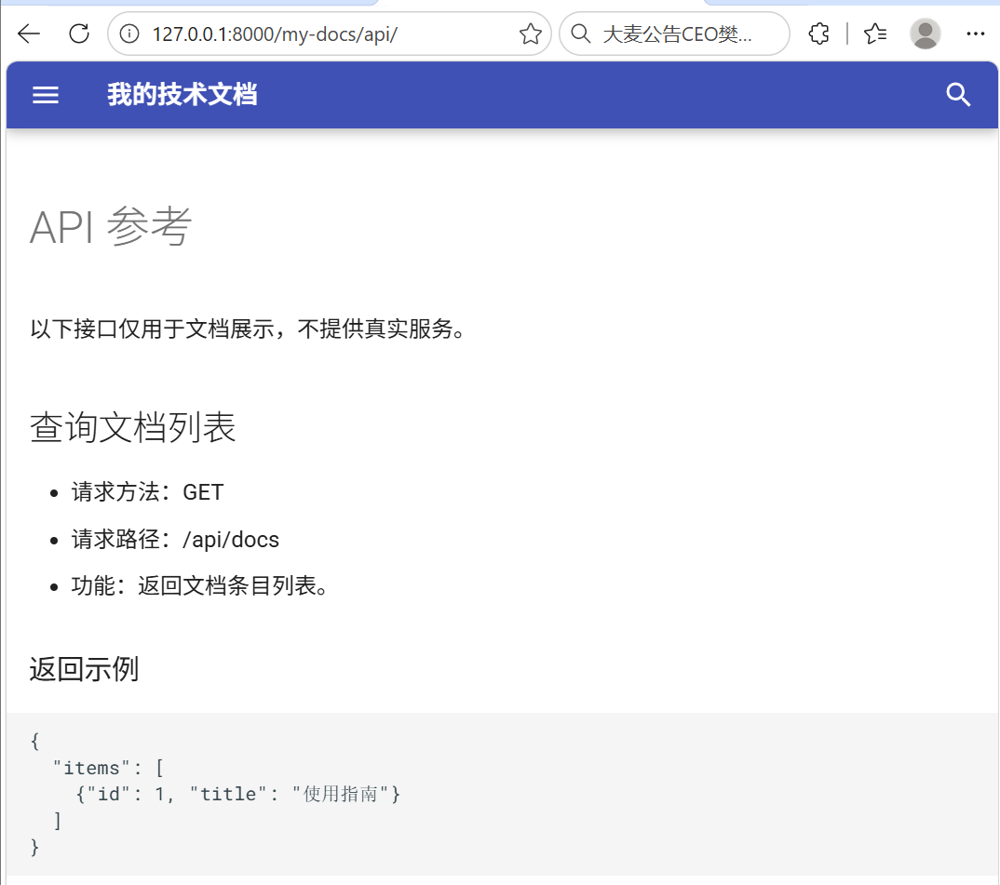

### 2.4 Pages 设置
操作：进入仓库 Settings → Pages，将部署来源选择为 GitHub Actions。
目的：开启 GitHub Pages 服务，允许 Actions 流水线自动发布静态网页。
结果：Pages 服务启用，等待工作流推送静态资源。
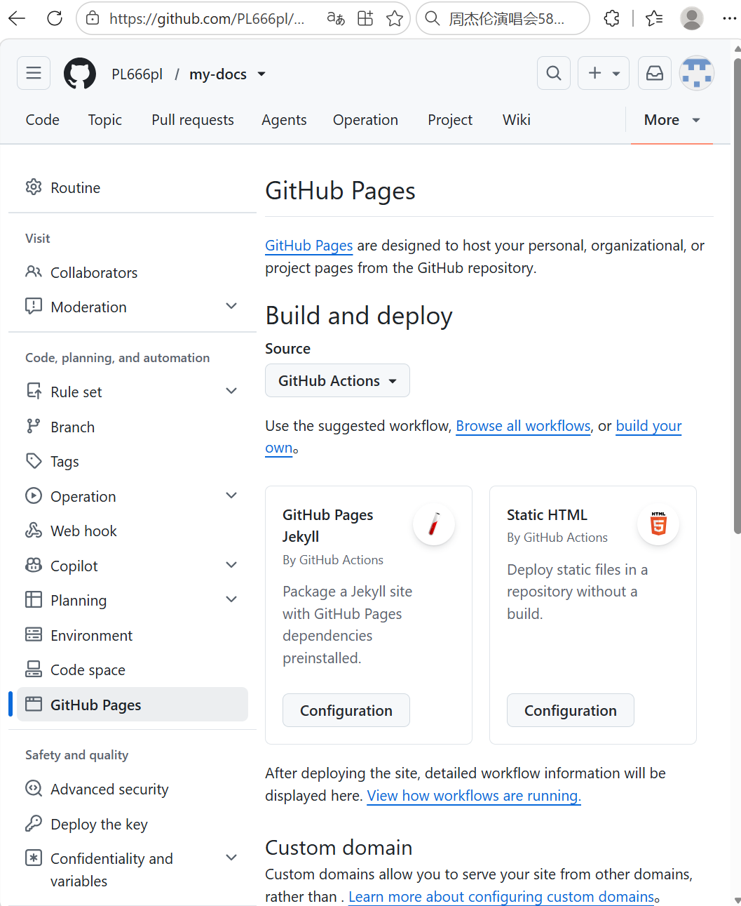

### 2.5 Actions 首次构建和部署
操作：在 `.github/workflows/` 目录下配置 `deploy.yml` 工作流文件，推送代码触发流水线自动运行。
目的：搭建 CI/CD 自动部署流程，代码提交后自动编译网页并发布到 GitHub Pages。
结果：流水线 build、deploy 任务全部执行成功，网站首次部署完成。
理解配置：
- `push`：向 main 分支推送指定文件时自动触发部署；仅修改 README 不会触发流水线。
- `workflow_dispatch`：支持在 Actions 页面手动运行工作流，方便调试重试。
- `build`任务：拉取源码、配置 Python3.12、安装依赖、构建文档并上传静态文件。
- `needs: build`：必须等待构建任务成功之后才执行部署。
- `pages: write`、`id-token: write`：单独授予部署所需权限，仓库全局权限保持只读。
- `github-pages`：GitHub 内置部署环境，用于记录部署并生成网站访问地址。
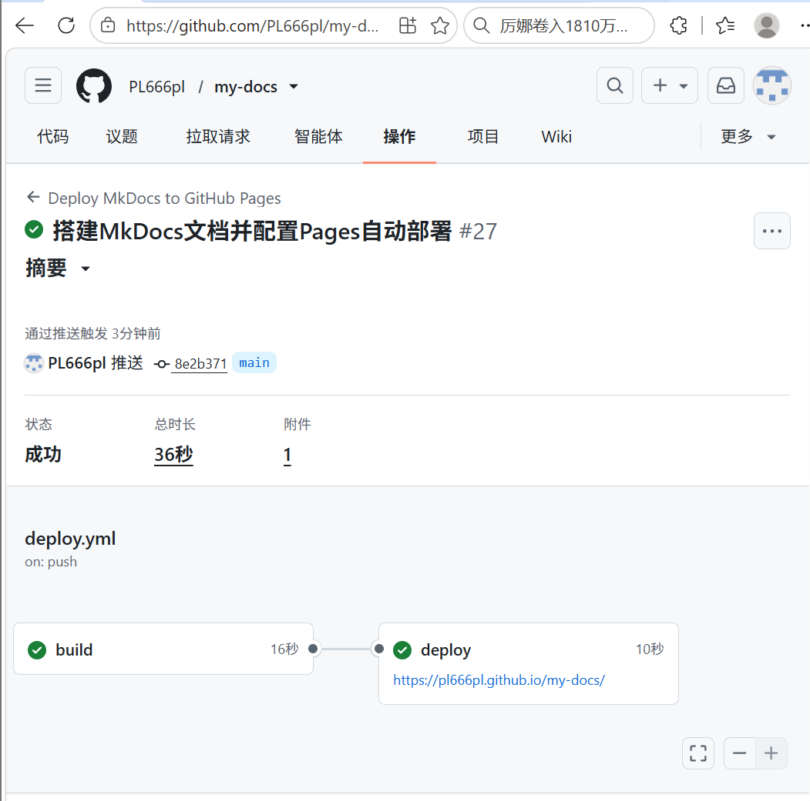

### 2.6 网站访问与四页导航检查
访问部署地址 `https://pl666pl.github.io/my-docs/`，网站首页正常加载，页面标题、介绍文本、作者信息展示无误。首页包含【关于本项目】【使用指南】【API 参考】三个文档跳转链接，依次点击可正常进入对应文档页面，各页面内容渲染正常，导航功能可用。
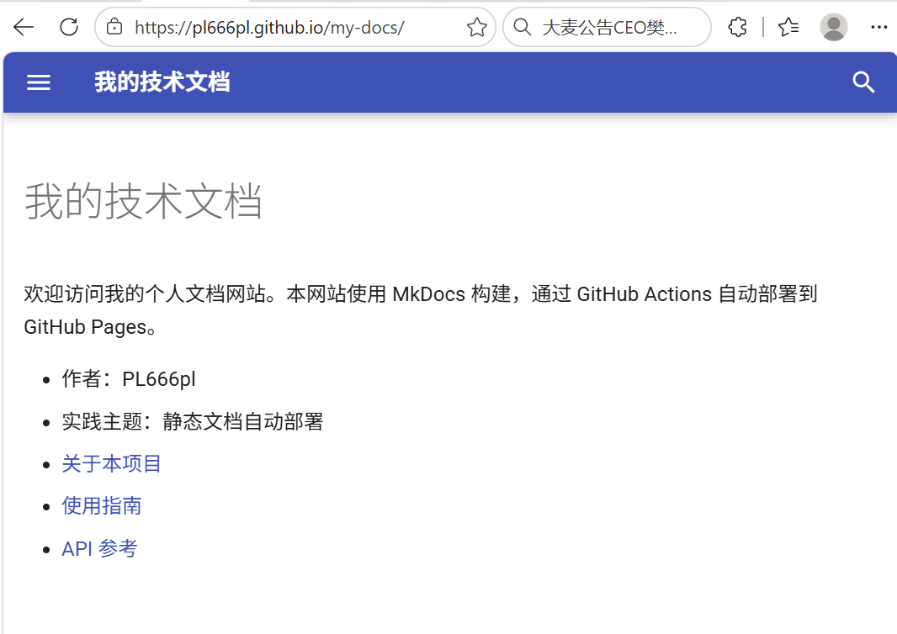

### 2.7 第二次推送与自动更新验证
操作：编辑 `docs/index.md`，在页面末尾添加验证文字，提交推送代码，不手动触发流水线。
目的：验证修改文档后，CI 流水线可以自动运行、网站自动更新。
结果：Actions 流水线自动触发并运行成功，打开网站可以看到新增的验证文本，自动更新生效。
- 对应提交链接：https://github.com/PL666pl/my-docs/commit/c6cb540
- 对应 Actions 运行链接：https://github.com/PL666pl/my-docs/actions/runs/43998434517
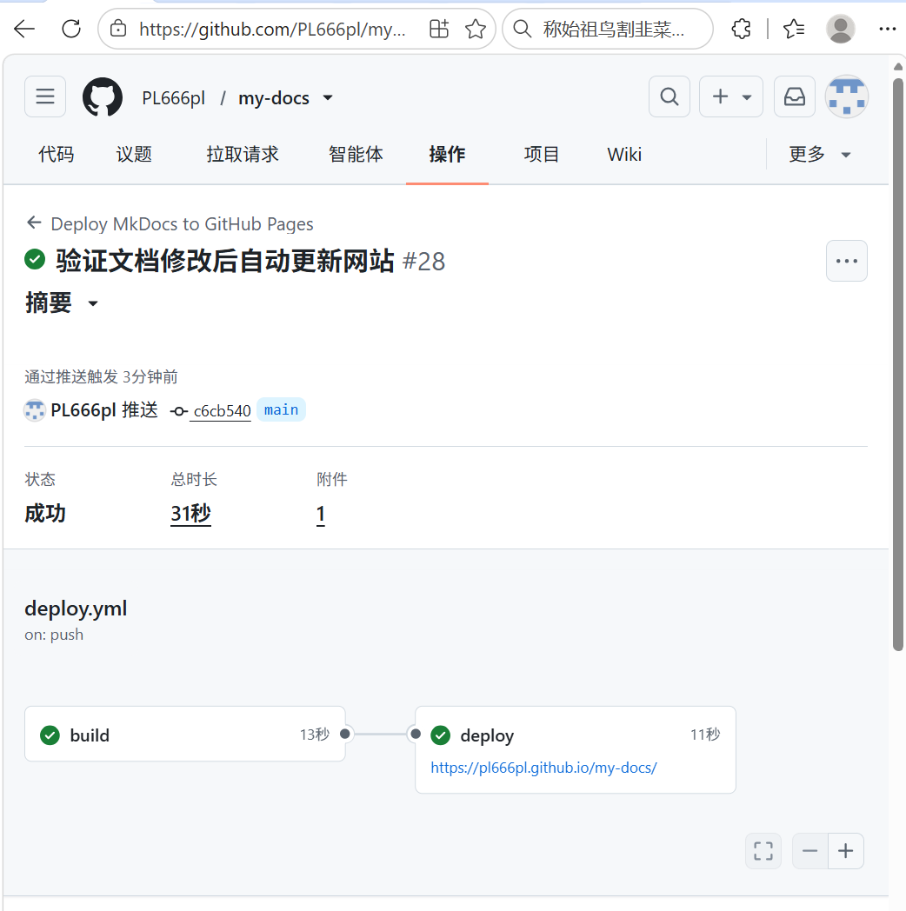
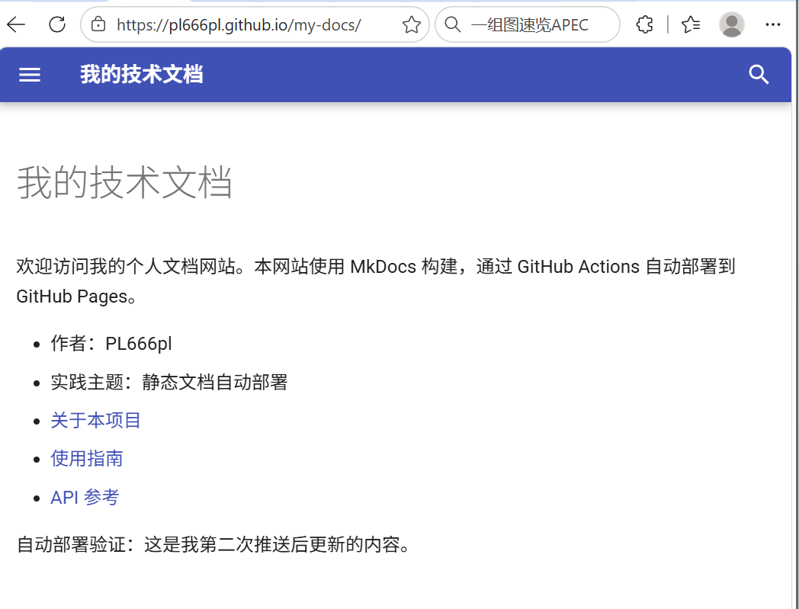

## 3. 问题与解决
本次实践过程中未出现报错。
核对日志信息：
1. 查看 Actions 的 build 日志，确认 MkDocs 文档编译无报错、无警告；
2. 查看 deploy 日志，确认静态文件上传至 GitHub Pages 服务成功；
3. 核对 `deploy.yml` 触发条件与 Pages 部署源配置，确认配置无误。

## 4. 原理理解
1. **docs/ 和 site/ 各保存什么？为什么不用手工修改 site/？**
`docs/` 存放我们编写维护的 Markdown 源文档；`site/` 是 MkDocs build 后自动生成的静态网页资源（HTML、CSS、JS）。
`site/` 属于编译产出，每次构建都会被覆盖重写，手动修改的内容会在下一次构建丢失，因此不手动修改 site。

2. **本次工作流在什么情况下自动运行？**
工作流配置 `on: push`，向 main 分支推送代码时自动触发运行。

3. **build 与 deploy 两个任务有什么区别？**
build：执行 `mkdocs build`，把 Markdown 源文档编译为静态网站文件；
deploy：将 build 产出的静态网页上传发布到 GitHub Pages，对外提供公网访问。
build 负责生成网页，deploy 负责发布网页。

4. **只修改 report/README.md 会触发部署吗？为什么？**
会触发流水线运行，但是网站内容不会更新。
因为 report 是实验报告，不属于 MkDocs 网站源码；虽然 push 事件触发工作流，但 docs 目录文档没有改动，编译出来的网站不会变化。本次作业预期：修改报告不改变文档网站。

5. **本次方案为何无需创建 gh-pages 分支？**
旧方案需要把 site 静态文件推送到 gh-pages 分支存放页面；新版 GitHub Pages + Actions 部署方式，deploy 动作直接上传静态资源到 Pages 托管存储，不再依赖 gh-pages 分支。
